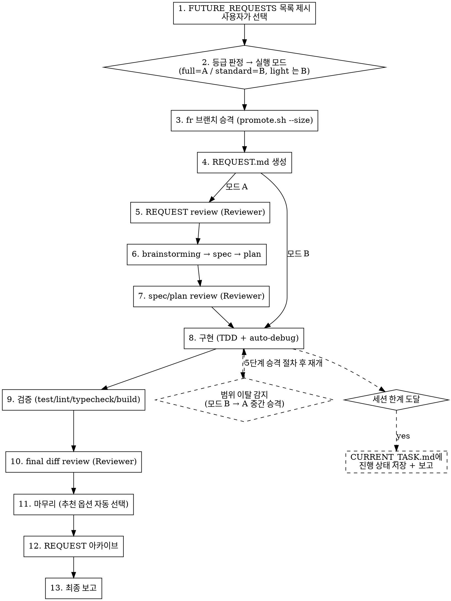

# Autopilot

FUTURE_REQUESTS에서 작업을 선택하고 파이프라인을 자율 실행한다. 실행 모드는 두 가지다 — 모드 A(`full` 등급: 모든 리뷰를 포함한 정식 절차 전부), 모드 B(`standard` 등급: final diff review 만). 모드는 `WORKFLOW.md` 위험 등급 절의 신호표로 판정한 등급이 정한다 ("실행 모드" 섹션).

## rd-workflow 버전 대조

이 skill 은 아래 `RD_SKILL_BASE` 보다 나중에 배포된 rd-workflow 를 전제한다. 첫 작업 단계보다 먼저, 프로젝트 루트에서 아래 명령을 이 호출에서 한 번 실행한다.

- 출력이 없으면 그대로 진행한다.
- 출력이 있으면 출력 전문을 사용자에게 알리고, 템플릿을 sync 할지 그대로 계속할지 묻고 멈춘다. 사용자가 계속을 지시하면 진행한다.
- autopilot·무인 실행처럼 물을 사람이 없으면 계속하지 않고 그 출력을 중단 사유로 보고한다.

```bash
bash -s <<'RD_SKILL_COMPAT'
RD_SKILL_BASE=2026-11-04-203832 RD_SKILL_NAME=autopilot
vf="rd-workflow/VERSION"
if [ ! -f "$vf" ] && [ -f "_ROOT_FILES/rd-workflow/VERSION" ]; then exit 0; fi
v=""; [ -f "$vf" ] && v="$(cat "$vf")"; v="${v#lite-}"
if [[ "$v" =~ ^[0-9]{4}-[0-9]{2}-[0-9]{2}-[0-9]{6}$ ]] && [[ "$v" > "$RD_SKILL_BASE" ]]; then exit 0; fi
echo "rd-workflow 버전 불일치 — skill '$RD_SKILL_NAME' 은 $RD_SKILL_BASE 보다 나중에 배포된 rd-workflow 가 필요합니다."
echo "프로젝트: $PWD"
echo "프로젝트 VERSION: ${v:-없음} (파일: $vf)"
echo "이 상태로 진행하면 skill 이 가리키는 문서 절·스크립트·인자가 없어 중간에 실패할 수 있습니다."
echo "해결: 템플릿을 sync 하십시오 (/tpl update 또는 rd-workflow/docs/guides/sync_template.md 절차)."
RD_SKILL_COMPAT
```

## Pipeline



## Autonomy Override (모든 하위 skill에 우선)

autopilot 실행 중에는 **자율 실행 공용 규칙**(`rd-workflow/docs/flows/AUTONOMY.md`)이 모든 하위 skill·prompt·기본 행동보다 우선한다 — "절대 멈추지 않는다"·"자율 판단 기준"·"중단 조건"을 그대로 따른다 (review 50턴, 디버깅 3회, loop-guard 등 중단 조건 포함).

**autopilot 특화 예외 게이트 (AUTONOMY.md 공용 규칙보다 우선):**
- §1의 작업 선택은 AskUserQuestion으로 **사용자가 결정한다**. 실행 모드는 등급 판정이 정하며 사용자는 이의가 있을 때만 바꾼다(하향 조건은 "실행 모드" 섹션). 이 게이트 이후부터 AUTONOMY.md 규칙이 적용된다.

## autopilot 적합성 기준

특정 FR 을 autopilot 으로 자율 실행할 수 있는지 판단하는 단일 출처 기준이다. autopilot 의 작업 선택(§1)과 `/fr inspect` 의 판정이 이 기준을 공통으로 사용한다 (inspect 는 별도 로직을 복제하지 않고 이 섹션을 인용한다).

판정 항목:

1. **request seed 구체성**: FR 의 `request seed` 로 `REQUEST.md` 를 생성할 수 있는가. 비어 있거나 모호하면 부적합 또는 조건부(seed 보강 필요).
2. **설계 결정 자동선택 가능성**: 설계 대안을 추천안 / REQUEST 제약·AC 부합 / 최단 규칙으로 결정할 수 있는가. 사람만 내릴 수 있는 본질적 선택(제품 방향, 외부 의존 채택 등)이 작업의 핵심이면 조건부 또는 불가.
3. **범위 폐쇄성**: 외부 시스템·사람 입력에 의존하지 않고 작업 범위가 닫혀 있는가. 외부 의존이 크면 조건부 또는 불가.
4. **리스크·비가역성**: 비가역 작업(외부 발행, 데이터 삭제 등)이나 PROJECT_CONTEXT 필수 제약 위반 위험이 있는가. 있으면 조건부(사람 승인 필요) 또는 불가.

판정 종합:

- **가능**: 4개 항목 모두 자율 진행에 무리가 없다.
- **조건부 가능**: 일부 항목이 충족 조건(예: seed 보강, 특정 결정에 대한 사람 승인) 하에서만 자율 진행 가능하다. 충족 조건과 사람 결정 필요 여부를 분리해 적는다.
- **불가**: 본질적 사람 결정이 작업 핵심이거나, 비가역·제약 위반 위험이 자율 진행을 막는다. 차단 사유를 적는다.

## 실행 모드

autopilot은 두 실행 모드를 제공한다. 모드는 작업 선택 직후 `WORKFLOW.md` 위험 등급 절의 신호표로 판정한 등급이 정한다 (§1).

| 모드 | 등급 | 파이프라인 |
|------|------|-----------|
| **모드 A** | `full` | 정식 절차 전부 — REQUEST review → brainstorming → spec → plan → spec/plan review → 구현 → 검증 → final diff review |
| **모드 B** | `standard` (그리고 `light` — autopilot 은 FR 큐 기반이라 REQUEST·아카이브가 있는 경로로 실행한다) | REQUEST review·spec/plan 작성·spec/plan review 생략, 나머지 동일 |

### 모드 결정 규칙

- 작업 선택 직후 autopilot 이 등급과 근거 신호를 판정해 그 등급의 모드로 진행한다. 시작 보고 블록은 1회만 낸다 — 모드 A(`full`) 는 판정 직후이되 WORKFLOW.md 의 비변경 preflight `bash rd-workflow/scripts/lifecycle/start_preflight.sh` 를 먼저 실행해 그 `push 예정`·`미병합 브랜치 FR 후보` 줄을 블록에 적고, 모드 B 는 §3 promote 직전에 시작 계약 5항을 확인한 직후(`push 예정 = archive.sh 경유`) 낸다. 두 모드 모두 preflight exit 10(등록 커밋 형태가 아닌 ahead·behind·diverged·fetch 실패) 이면 autopilot 은 지시 대기가 없으므로 시작하지 않고 인계한다 — ahead 가 전부 FR 등록 커밋이면 자동 채택(exit 0) 되어 시작한다. preflight 의 fetch 실패는 `미push 수 판정 실패: 사유` 로 적고 무인 모드에서는 인계한다. 의미 신호로 판정 불가면 `full`(모드 A), 인접 두 등급 사이가 모호하면 높은 등급이다(`light`↔`standard` 는 `standard`/모드 B, `standard`↔`full` 은 `full`/모드 A).
- 상향은 언제나 가능하다. 하향은 WORKFLOW.md 위험 등급 절의 하향 조건을 따르며 autopilot 도 근거를 적고 모드 B 로 내릴 수 있다. `RD_AUTOPILOT_MODE=B` 는 사용자 하향이다. 되돌리기 어려운 효과가 있는 FR 은 어떤 하향으로도 모드 B 가 될 수 없다. 하향은 주체와 함께 REQUEST `## Risk Tier` 이력에 적는다.

### 모드 B 실행 규칙

- **생략**: REQUEST review, brainstorming → spec → plan 설계 단계, spec/plan review
- **유지**: REQUEST.md 생성(§1 — 축약형, `## Risk Tier` 최종 등급 `standard`), fr 브랜치 승격(§3), 구현·검증(§4), 커밋 전 재분류, **final diff review(`standard`·`full` 필수)**, 마무리·아카이브(§6), 최종 보고(§7)
- **promote 타이밍**: 모드 A·B 모두 FR 등록 커밋 직후 promote 한다 (§3). 모드만 `--size` 값이 다르다 — A 는 `large`, B 는 `small`.
- **AC 게이트**: REQUEST.md의 Acceptance Criteria가 비어 있거나 모호하면 구현을 시작하지 않는다. request seed로부터 구체적 AC를 생성하는 것이 REQUEST 생성 단계의 책임이며, seed가 빈약해 AC를 만들 수 없으면 `awaiting-user`로 멈춘다.
- 그 외 공통 규칙(Autonomy Override, §4의 자율 구현 규칙 전체, §5 세션 한계 대응, §2 리뷰 수렴 규칙)은 모드 B에도 전부 동일 적용된다.

### 범위 이탈 시 중간 승격 (모드 B → 모드 A)

구현 중 `WORKFLOW.md` 위험 등급 절의 `full` 신호(되돌리기 어려운 효과, 워크플로 인프라 동작 변경, 인터페이스·데이터 모델·기존 동작 변경, 새 기능)가 하나라도 실제로 나타나면(하향 근거에 적은 신호는 제외 — WORKFLOW.md 「커밋 전 재분류와 상향」. 새 신호·되돌리기 어려운 효과는 승격) **멈추지 않고** 모드 A로 승격한다. 감지 시점은 각 구현 사이클 시작 시와 구현 중 새 요구 발견 시다.

승격 절차 (5단계):

1. 현재까지의 구현을 fr 브랜치에 WIP 커밋한다 (구현 유지).
2. `CURRENT_TASK.md` Status를 `spec/plan 작성 중`으로 갱신하고 Notes에 승격 사유를 기록한다.
3. change-spec + plan을 소급 작성한다 — 이미 구현된 부분은 "현재 상태"로 반영하고 남은 작업을 plan Task로 정의한다 (`specs/changes/`, `plans/` 컨벤션 그대로).
4. spec/plan review를 실행한다 (§2 리뷰 패턴과 동일). Reviewer가 기존 구현의 문제를 지적하면 자율 수정한다.
5. 리뷰 통과 후 잔여 구현부터 모드 A와 완전히 동일하게 진행한다.

- **REQUEST review는 소급하지 않는다** — 범위 이탈은 규모 추정의 문제이지 REQUEST의 문제가 아니다. REQUEST 자체의 전제가 깨진 경우(요구사항 변화)는 기존 예외("사람의 우선순위 결정이 반드시 필요한 경우")에 따라 멈춘다.
- 승격은 단방향이다 (모드 A → B 강등 없음).
- 승격 사실과 사유를 최종 보고서 "주요 결정" 테이블에 기록한다.

## 무인 진입 (headless / unattended)

`claude -p` 헤드리스에서 사람 개입 없이 autopilot 을 완주시키는 비대화형 진입 경로다. 두 front-end(ralph 무인 큐 드레인 · batch 큐레이션 묶음)가 공통으로 이 경로를 통해 진입하며, 얇은 wrapper `rd-workflow/scripts/autopilot_headless.sh` 가 진입점이다. front-end A(ralph 무인 큐 드레인)의 진입점은 supervisor 스크립트 `rd-workflow/scripts/ralph_drain.sh` 다 — wrapper 를 `RD_AUTOPILOT_FR=auto` 로 반복 호출해 준비된 큐를 소진하고, exit code(0/10/20/30/40)만 보고 계속/중단하며 blocked FR 은 위 status=blocked 처리로 자동 제외된다. 오케스트레이션 지능은 넣지 않는다.

### 활성화 신호

- 환경변수 `RD_AUTOPILOT_FR` 이 설정되어 있으면 무인 분기로 동작한다. unset 이면 기존 대화형 분기(§1 AskUserQuestion)로 동작한다 (기존 동작 불변).
- 무인 분기에서는 §1 작업 선택의 `AskUserQuestion` 호출을 전면 금지한다. 헤드리스에는 AskUserQuestion 도구가 존재하지 않으므로, 반드시 환경변수로 대체한다.

### 결과 대기 규율 (백그라운드 금지)

무인 분기의 필수 제약이다 (위 AskUserQuestion 금지와 같은 층위). 이 규율은 Claude Code headless 실행 환경의 도구 계약(Bash `timeout` 기본값·상한, timeout 도달 시 자동 백그라운드 이관)에 근거하므로, 다른 harness 로 이 템플릿을 운용하는 경우에는 동일 동작이 보장되지 않는다.

**자멸의 직접 원인은 "세션이 스스로 백그라운드를 시작했는가" 다.** harness 자동 이관은 명령이 timeout 에 닿을 때만 일어난다. 이관되면 재진입은 하지만 이관된 명령이 백그라운드 시간 제한(약 10분)에 걸리면 결과를 잃으므로, wrapper 가 timeout 을 올려 이관 자체를 피한다.

| 백그라운드 시작 주체 | 결과 |
|---|---|
| 세션이 스스로 `run_in_background: true` 로 던짐 | **자멸** — 응답을 내는 순간 프로세스가 종료되어 결과를 수령할 주체가 사라진다. outcome 이 빈 채 남아 wrapper 가 `harness-error`(exit 40) 로 매핑한다 |
| foreground 명령이 시간 초과로 harness 가 자동 이관 | **이관 뒤 재진입은 동작하나, 이관된 명령은 백그라운드 시간 제한(`-p` 텍스트 프롬프트 기준 약 10분)에 걸려 결과 없이 중단된다** — 실측(2026-10-29, Claude Code 2.1.312): 150초 명령은 120초에 이관된 뒤 완료 알림으로 정상 완주, 750초 명령은 이관 뒤 `[killed]` 로 끝나 `outcome` 이 빈 채 남는다. 12분짜리 `self_test` 가 이 경로로 죽은 것이 FR `headless-verification-exceeds-bash-timeout` 의 원인이다. 이관 자체를 피해야 하며 wrapper 가 timeout 을 올려 준다 |

1. **결과가 필요한 명령을 `run_in_background: true` 로 시작하지 않는다.** 리뷰 턴 실행, 빌드, 검증 스크립트, subagent dispatch 가 모두 해당한다. 결과를 쓰지 않고 던져두기만 하는 명령에만 백그라운드를 쓴다.

   이 금지는 산문 규율이 아니라 **`headless_background_gate.sh` PreToolUse hook 으로 강제됩니다.** `RD_AUTOPILOT_FR` 이 설정된 세션에서 `run_in_background: true` Bash 호출은 exit 2 로 차단되며, 차단 메시지가 foreground 대안(`timeout` 인자 생략 또는 유효 값 이하)과 리뷰 턴의 `WAIT_TIMEOUT` 조정법을 함께 제시합니다. hook 은 positive 감지에만 차단하므로(파싱 불가·필드 부재는 통과) 정상 호출을 막지 않습니다.
2. **긴 명령도 foreground 로 건다.** wrapper 가 자식 세션에 `BASH_DEFAULT_TIMEOUT_MS`(기본 7500000)를 올려 주므로 **Bash 호출의 `timeout` 인자는 생략하는 것이 기본이다.** 지정하지 않는다 — 세션은 유효 상한(호출자가 정한 `BASH_DEFAULT_TIMEOUT_MS`)을 볼 수 없어서, 지정한 값이 상한을 넘으면 잘리고 기본값보다 낮으면 오히려 이관을 앞당긴다(wrapper 의 값 출력 줄은 호출자 터미널로 나가며 세션 컨텍스트에 들어오지 않는다). 소요가 유효 값을 넘을 것 같아도 세션은 자기 env 를 바꿀 수 없다. 아래 4항대로 outcome 에 `resume` 을 기록하고 중단 이유에 필요한 timeout 을 적어 정상 종료하면, 사람 또는 호출자가 `BASH_DEFAULT_TIMEOUT_MS` 를 올려 재개한다. 스스로 백그라운드를 선택하지 않는다.

   **명령 자체에 watchdog 이 있으면 바깥(Bash 대기)을 안쪽 watchdog 보다 크게 잡는다.** 바깥이 먼저 끝나면 안쪽 watchdog 이 동작하기 전에 명령이 이관된다. 기본값 7500000ms(7500초)는 `WAIT_TIMEOUT` 기본 7200초보다 크므로 기본 설정에서는 안쪽이 먼저 동작한다. `WAIT_TIMEOUT` 을 올리려면 바깥(`BASH_DEFAULT_TIMEOUT_MS`)도 호출자가 함께 올려야 한다 — 세션 안에서는 바꿀 수 없으므로 올려야 할 때는 위 `resume` 경로를 쓴다. `run_review_turn.sh` 의 어댑터는 두 축으로 대기한다 — 유휴 임계 `RD_REVIEW_IDLE_TIMEOUT`(기본 600초)과 절대 상한 `WAIT_TIMEOUT`(기본 7200초). **codex 가 출력을 내는 동안에는 유휴 타이머가 계속 갱신되므로, 정상 진행 중인 턴이 상한 전에 잘리지 않는다.** 따라서 종전처럼 `WAIT_TIMEOUT` 을 매번 올려 걸 필요가 없다.

   ```bash
   bash rd-workflow/scripts/run_review_turn.sh <session-path>
   ```

   기본값으로 충분하다. 대상이 유난히 크거나 이전 회차가 상한에서 끊겼다면 그때만 `WAIT_TIMEOUT` 을 올리되, 바깥 Bash 대기가 그보다 크게 유지되는지 먼저 확인한다(유지되지 않으면 올리지 말고 `resume` 경로를 쓴다).
3. **소요 시간으로 자기 판단하지 않는다.** 리뷰 종류별 실측 소요는 편차가 크다.

   | 리뷰 종류 | 실측 소요 |
   |---|---|
   | REQUEST review (턴당) | 64~89초 |
   | spec/plan review | 약 26분 |
   | final diff review | 600초 초과 |

   한 종류의 값을 다른 종류에 적용하면 안 된다. 위 값은 특정 회차의 **관측값이지 보장치가 아니며**, 대상 규모·모델·부하에 따라 달라진다. 이 표의 목적은 값을 신뢰하라는 것이 아니라 종류마다 다르므로 한 값을 일반화하지 말라는 것이다. **이 표의 값은 더 이상 타임아웃 설정의 근거가 아니다** — 유휴 기반 대기로 바뀌어 소요 시간 자체가 판정 기준이 아니기 때문이다. 표는 "리뷰 종류마다 소요가 다르다"는 사실만 말한다.
4. **세션 수명이 다하면 백그라운드로 도망가지 않는다.** `CURRENT_TASK.md` 에 진행 상태를 저장한 뒤 outcome 에 `resume` 을 기록하고 정상 종료한다. 재개에 필요한 세 정보 — **중단 이유 / 도달 단계 / 다음 재개 지점** — 를 두 곳에 남긴다.
   - `CURRENT_TASK.md` — §5 의 기존 항목(완료된 단계, 현재 단계와 남은 작업, 열린 리뷰 세션 경로, 다음 세션에서 이어갈 명령)으로 충족한다.
   - outcome 파일의 **2줄 이후** 요약. **첫 줄은 토큰 전용이다** — wrapper 가 `head -n1` 로 첫 줄만 읽으므로, 첫 줄에 요약을 섞으면 토큰 판독이 깨져 `harness-error` 로 오분류된다.
5. **긴 foreground 에 들어가기 전에 무엇을 기다리는지 남긴다.** 수백 초 이상 이어지는 무응답 구간은 겉보기에 정체와 구별되지 않는다. 무인 세션에는 화면을 보는 사람이 없으므로 파일이 유일한 관찰 지점이다. 명령 실행 **직전** `CURRENT_TASK.md` Notes 에 진행 신호 한 줄을 기록하고, 복귀 후 같은 줄을 결과로 갱신한다.

   ```
   waiting: final diff review 턴 003 / run_review_turn.sh / started 17:42
   ```

### 실행 비용 줄

wrapper 는 claude 를 부른 실행마다 비용 줄 하나를 stdout 에 낸다. 출력 순서는 결과 요약 줄 → 발행 줄(`autopilot_headless: 발행 …`, 발행 단계가 돈 경우만) → 비용 줄 → outcome 상세 줄이다. 이 줄은 exit code 판정에 쓰지 않는다.

```
autopilot_headless: 완료 (completed) [exit 0]
autopilot_headless: 실행 비용 $0.4213 (정가 환산) · 토큰 입력 1,204 · 출력 38,910 · 캐시 쓰기 210,334 · 캐시 읽기 5,812,007 · 소요 37.2분 · 턴 58
```

- 값은 `claude -p --output-format json` 결과의 `total_cost_usd`·`usage`·`duration_ms`·`num_turns` 다. `python3` 실행 검사가 통과한 경로만 JSON 으로 띄우고, 사람에게 보이는 본문(`result`)은 종전 text 출력 자리에 그대로 낸다.
- 비용은 정가 환산값이다. 구독 계정의 실제 청구액이 아니다.
- 자식 세션이 따로 띄운 리뷰 도구(codex, claude 리뷰 어댑터)의 비용은 들어가지 않는다.
- 값을 읽지 못하면 `autopilot_headless: 실행 비용 확인 불가 — <사유>` 를 낸다. 시간 상한 강제 종료·크래시(`claude 결과 출력 없음`), JSON 형식 변화, `python3` 를 쓸 수 없는 환경(`python3 를 쓸 수 없음 (text 출력으로 실행)`)이 여기에 해당한다.
- 값은 wrapper 호출 1회 기준이다. 한 FR 이 `resume` 으로 여러 번 호출되면 호출마다 줄이 하나씩 나온다.
- 발행 단계는 `archive.sh` 를 돌리기 직전에 stderr 로 `autopilot_headless: 발행 시작 — task <이름> · <정책> 정책 · 로그 <경로>` 한 줄을 낸다. 로그는 `<git 공용 디렉터리>/rd-workflow/autopilot-publish/<이름>-<시각>.log` 에 실시간으로 쌓인다(같은 초에 같은 이름이 있으면 `-<n>` 을 붙인다).
- `RD_AUTOPILOT_COST_FILE` 이 비어 있지 않으면 wrapper 가 claude 실행 뒤(발행 단계 뒤에도) 이 파일에 기계 판독 줄 하나를 덧붙인다. 값을 읽었으면 `cost<TAB>ok<TAB><USD 6자리>`, 읽지 못했으면 `cost<TAB>unknown<TAB><사유>` 다(사유는 사람용 줄의 「확인 불가 — 」 뒤 문구). 덮어쓰지 않고 덧붙이므로 한 FR 의 `resume` 호출이 한 파일에 쌓인다. 쓰기에 실패하면 stderr 에 `autopilot_headless: 경고 — 비용 기록 실패: <경로>` 만 내고 outcome 과 exit code 는 바꾸지 않는다. NO_INVOKE 는 아무것도 쓰지 않는다.
- `ralph_drain.sh` 는 드레인마다 파일 하나를 넘기고(자체 임시 파일, 또는 호출자의 `RD_AUTOPILOT_COST_FILE` 에서 드레인 시작 뒤 추가된 줄만 센다) 최종 요약에 `실행 비용 합계: …` 를 낸다. 합계는 달러(소수 4자리)·wrapper 호출 수·확인 불가 수를 담는다. 비용 기록이 없는 호출이 있으면 「비용 기록 없는 호출 N회 — 일부 호출 누락, 실제 비용은 더 큼」 을 덧붙이고, 파일을 만들거나 읽지 못하면 「집계 불가 — <사유>」 를 낸다. 합계도 정가 환산값이며 리뷰 도구 비용은 빠진다.
- §7 완료 보고 파일에는 이 값을 넣지 않는다. 보고 파일은 세션이 끝나기 전에 커밋·발행되고, 값은 세션이 끝난 뒤에야 wrapper 가 얻는다.

### 환경변수 계약

| 변수 | 값 | 역할 |
|------|-----|------|
| `RD_AUTOPILOT_FR` | `<slug>` \| `auto` | 존재=무인 활성화. `<slug>`=명시 FR, `auto`=priority 자동선택 |
| `RD_AUTOPILOT_MODE` | `A` \| `B` | 미지정이면 등급 판정이 모드를 정한다. 지정하면 사용자 override 로 취급한다(`B` 는 하향 — 되돌리기 어려운 효과가 있는 FR 에는 적용되지 않고 A 로 진행 + 보고) |
| `RD_FINISH_POLICY` | `push` \| `merge` \| `none` | 미지정 시 `push`. `push`=정규 archive.sh 전체, `merge`=로컬 merge+tag(push 생략), `none`=fr branch 커밋만. wrapper 가 해석해 `archive.sh` 인자로 옮긴다(`merge`=`--no-remote`). 무인 front-end 를 띄울 때 고른 이 값이 발행 승인이며, 무인 경로는 발행 요청 큐(`rd publish request`)를 쓰지 않는다 |
| `RD_AUTOPILOT_OUTCOME_FILE` | 경로 | outcome 기록 대상. wrapper 가 설정해 주입 (기본 `rd-workflow-workspace/.autopilot-outcome`) |
| `RD_AUTOPILOT_COST_FILE` | 경로 | 비어 있지 않으면 wrapper 가 실행마다 `cost<TAB>ok<TAB><USD>` 또는 `cost<TAB>unknown<TAB><사유>` 줄을 덧붙인다(덮어쓰지 않음). worktree 밖 경로나 gitignore 된 경로만 쓴다 — 미추적 파일은 다음 발행의 clean 검사를 막는다. batch 류 호출자 권장: `$(git rev-parse --path-format=absolute --git-common-dir)/rd-workflow/batch-cost/<slug>.tsv` |
| `RD_PUBLISH_WALL_MINUTES` | 분(소수 허용) | 발행 단계(`archive.sh`)의 경과 시간 상한. 미지정 시 `loop-guard.json` 의 `publish_wall_minutes` 키, 그것도 없으면 기본 30분 순으로 정한다. `0`=상한 없음. 초과하면 TERM → 유예 → KILL 이고 유예는 `RD_FR_WALL_GRACE_SECONDS` 를 공유한다 |

### 무인 분기 작업 선택 (§1 게이트 대체)

1. **resume 우선**: `bash rd-workflow/scripts/batch/resume_candidates.sh` 를 실행하고 **첫 줄과 종료 코드**로 분기한다. 후보 계산은 이 스크립트가 한다 — 여기서 다시 계산하지 않는다. 출처는 메인 `CURRENT_TASK.md` 가 아니라 tasks 색인과 각 worktree 의 `task-state` 다(`promote.sh` 는 작업 상태를 fr worktree 에 쓰고 메인 파일은 baseline 으로 둔다). 읽기 전용이다.
   - 첫 줄이 `select<TAB><slug><TAB><worktree>`: 그 worktree 로 이동해 그 FR 을 재개한다 (§5 재사용). `RD_AUTOPILOT_FR=auto`(또는 미지정)이면 스크립트가 고른 후보가 대상이고, `RD_AUTOPILOT_FR=<slug>` 이면 스크립트가 그 slug 만 `select` 한다 — batch 는 요청한 FR 의 결과를 그 FR 에 적용하므로 다른 작업을 재개하면 요청 FR 이 실행되지 않은 채 blocked 로 오판되기 때문이다. 명시 slug 가 후보가 아니면 스크립트가 `none` 을 내고 다른 후보는 `skip` 줄(`명시 FR <slug> 지정 중`)로만 보고한다.
   - `select` 로 그 worktree 로 이동해 재개한 직후 `bash rd-workflow/scripts/autopilot_driver.sh begin` 을 실행한다.
   - 첫 줄이 `none`: 2·3항으로 내려간다.
   - 첫 줄이 `undetermined` (rc=3): `RD_AUTOPILOT_FR` 값과 무관하게(`auto` 든 명시 slug 든) 새 작업을 시작하지 않는다. outcome `blocked:resume-undetermined` 를 기록하고 스크립트 출력의 둘째 줄 이후를 outcome 둘째 줄부터 그대로 옮긴 뒤 종료한다. 생존·소유를 확인할 수 없는 작업을 가로채지 않으려는 것이다. 이 실패는 FR 을 고르기 전의 전역 실패이므로 `ralph_drain.sh` 가 즉시 중단하며, FR status 를 바꾸거나 `CURRENT_TASK` 를 초기화하지 않는다 — 대상 FR 이 없다.
   - 어느 경우든 outcome 둘째 줄 이후에 `재개: <slug> <worktree> (<선택 이유>)` 줄과 스크립트의 `skip`·`info` 줄(제외 사유·다음 조치, 종료 확인 근거)을 적는다. 첫 줄은 토큰 전용이다.
   - 후보가 여럿이면(`auto` 일 때) `RD_AUTOPILOT_FR` 과 같은 slug 를 먼저, 없으면 색인 순서 첫 후보를 스크립트가 고른다. `launch=ok`(대화형 세션을 기동한 적 있음) 작업은 세 갈래로 나뉜다. 세션 종료가 확인되면(herdr·프로세스 관측이 모두 완전하고 세션 없음) 후보가 되고, 색인의 launch 값은 바뀌지 않는다. herdr app 으로 기동한 작업(`launch-backend=hc`)은 이름 조회를 `hc get` 으로 한다. 세션이 살아 있으면 제외한다 — 사용자의 대화형 작업을 가로채지 않는다. 판정할 수 없으면(herdr 없음·조회 실패·시간 초과·불완전 관측) 제외하고 `rd task resolve-launch <slug> --assume-ended` 로 수동 확정하라고 안내한다.
2. else `RD_AUTOPILOT_FR=<slug>` → 그 FR 을 선택한다.
3. else `RD_AUTOPILOT_FR=auto` → `bash rd-workflow/scripts/fr_relations.sh auto-pick --root .` 를 실행하고 **첫 줄과 종료 코드**로 분기한다. 후보 집합 계산과 갈림 판정은 이 스크립트가 한다 — 여기서 다시 계산하지 않는다. `eligible` 은 **validated / ready-for-request 후보**(기존 화이트리스트 그대로, `blocked` 은 set-aside 라 제외)이고, `selectable` 은 그중 관계 판정이 `ready` 인 것이다.
   - 첫 줄이 `unavailable` (rc=2): outcome `blocked:relations-unavailable` 을 기록하고 종료한다. 스크립트 출력의 둘째 줄 이후를 outcome 둘째 줄부터 그대로 옮긴다. 이 실패는 FR 을 고르기 전의 전역 실패이므로 `ralph_drain.sh` 가 즉시 중단하며, 일반 blocked 처럼 FR status 를 바꾸거나 `CURRENT_TASK` 를 초기화하지 않는다 — 대상 FR 이 없다.
   - 첫 줄이 `select<TAB><stem>`: 그 FR 로 진행한다.
   - 첫 줄이 `queue-empty`: outcome `queue-empty` 를 기록하고 종료한다.
   - 첫 줄이 `queue-blocked`: outcome `queue-blocked` 를 기록하고, 스크립트 출력의 둘째 줄 이후를 outcome 둘째 줄부터 그대로 옮긴 뒤 종료한다.

   outcome 둘째 줄 이후의 형식은 `<short-title><TAB><착수 상태><TAB><다음 조치>` 이며 `auto-pick` 이 만든 그대로다. 이 줄들이 `autopilot_headless.sh` 와 `ralph_drain.sh` 를 거쳐 사용자 요약에 실린다.

모드는 `RD_AUTOPILOT_MODE` 가 미지정이면 등급 판정이 정한다(`full`→A, `standard`→B, `light` FR 은 B). 지정하면 사용자 override 로 취급한다. 이 두 게이트 이후부터는 AUTONOMY.md 자율 규칙을 그대로 적용한다.

### outcome 기록 (종료 신호)

무인 분기에서는 종료 시 반드시 `$RD_AUTOPILOT_OUTCOME_FILE`(미설정 시 `rd-workflow-workspace/.autopilot-outcome`) 의 첫 줄에 아래 토큰 하나를 기록한다. wrapper 가 이를 exit code 로 매핑한다.

| outcome 토큰 | 의미 |
|--------------|------|
| `completed` | FR 완료 + `RD_FINISH_POLICY` 대로 발행 완료. `none` 정책이면 세션이 쓴다. `push`·`merge` 정책이면 wrapper 가 발행 성공 뒤 쓴다. 정리 잔여 기록이 실패했지만 발행은 끝난 경우에는 둘째 줄에 `cleanup-record-failed` 를 덧붙인다. 무인 경로는 wrapper 가 `cleanup-record-failed <slug> <발행 로그 경로>` 를 쓴다. 정리 잔여가 있으면 wrapper 는 기록 실패가 아닌 정상 완료에도 발행 로그의 `archive: CLEANUP-PENDING` 블록을 outcome 뒤에 옮긴다. 대화형 경로는 세션이 `cleanup-record-failed <slug> <autopilot 보고서 경로>` 를 쓴다(§6 7단계 판정) |
| `publish-ready` | 세션→wrapper 내부 토큰. 기록 커밋까지 끝났고 발행만 남음. 둘째 줄 `task <작업 이름>`. `push`·`merge` 정책에서만 세션이 쓴다. wrapper 가 발행한 뒤 아래 결과 토큰으로 바꾸므로 front-end 에는 나오지 않는다 |
| `blocked:publish-failed` | wrapper 가 씀. `archive.sh` 가 merge 전에 실패함. 기본 브랜치는 그대로이고 worktree 는 보존된다. exit 20 |
| `blocked:publish-incomplete` | wrapper 가 씀. merge 는 됐지만 tag·push·정리가 끝나지 않음. 「다음:」 줄은 사유 줄의 원인을 해소한 뒤 `archive.sh --fr-branch fr/<이름>[ --no-remote]` 로 이어붙이라고 안내한다. exit 20 |
| `blocked:publish-unsafe` | wrapper 가 씀. 발행은 됐지만 안전 불변식 위반으로 ref 정리가 멈춤. `archive.sh` 를 다시 돌리지 말고 ref 를 수동 정리한다. exit 20 |
| `resume` | 세션 한계 도달, CURRENT_TASK 저장, 잔여 작업 있음 |
| `blocked:<reason>` | AUTONOMY 중단조건 도달. `<reason>` 은 하이픈 식별자(예: `review-50turn`, `debug-3fail`, `loop-guard`, `human-decision`) |
| `queue-empty` | auto-pick 후보 없음 |
| `queue-blocked` | 착수 가능 FR 없음 — 남은 FR 이 전부 의존 대기·확인 필요·관계 오류 |
| `blocked:relations-unavailable` | `fr_relations.sh` 관계 판정이 rc=2 로 실패 — 판정 불가 |
| `blocked:resume-undetermined` | 재개 후보 판정 불가 — 생존·소유를 확인할 수 없는 작업만 있음(전역 실패, 대상 FR 없음) |

발행 시간 상한 초과·발행 중 신호도 위 `blocked:publish-failed`·`publish-incomplete`·`publish-unsafe` 세 토큰으로 나옵니다(사유 첫 줄에 원인).

`blocked:publish-*` 는 둘째 줄 이후에 `사유:`·`로그:`·`다음:` 줄을 싣는다(`로그:` 는 로그를 만들기 전의 조기 실패에는 없다. `다음:` 은 `unsafe` 와 조기 실패를 포함한 모든 발행 실패에 있다). `ralph_drain.sh` 는 이 세 사유에서 즉시 멈춘다(다음 FR 로 넘어가지 않음). 시간 상한 전에 `publish-ready` 를 기록했고 자손 프로세스를 정리했으면 wrapper 는 그대로 발행한다. 발행 단계는 claude 종료 뒤에 돌며 시간 상한이 감시하지 않는다. 종료 코드 표는 바뀌지 않는다. 종전처럼 세션이 직접 `archive.sh` 를 돌리고 `completed` 를 쓰는 경우도 exit 0 으로 매핑한다.

### 중단조건 → blocked 매핑 (무인 특화)

무인 모드에서는 사람을 기다릴 수 없다. AUTONOMY.md 중단조건(review 50턴 / 디버깅 3회 / loop-guard / 본질적 사람 결정 / 판단 근거 없음)에 도달하면, "awaiting-user 로 멈춰 대기" 하는 대신 아래를 수행하고 종료한다:

1. `blocked:<reason>` outcome 을 `$RD_AUTOPILOT_OUTCOME_FILE` 에 기록한다.
2. 해당 FR 의 status 를 `blocked` 로 기록한다 (FUTURE_REQUESTS.md 인덱스 status 컬럼 + `items/` 상세 파일 status, 상세에 중단 사유 한 줄 병기). auto-pick 화이트리스트(validated/ready-for-request)가 이 FR 을 자동 제외한다.
3. **fr 브랜치가 활성인 작업은 worktree 유무와 무관하게 `CURRENT_TASK.md`·task-state 를 초기화하지 않고 그대로 둔다.** `task_reset_title` 은 worktree 가 아니라 task-state 의 fr ref 활성 여부로 거부하고(작업 이름은 archive 까지 유지), 활성 작업은 중단 시점 작업물의 증거이기 때문이다. `Status`·`launch`·Short Title 이 남아도 정상이다. 초기화(Status `대기 중`, Short Title `-`)는 `rd task set-title -` 를 호출해 `task_reset_title` 의 허용 판정(Status `대기 중` 이고 fr-branch 비활성)에 맡기고, 거부되면 보존으로 처리한다. `--force` 로 우회하지 않는다.
4. 다음 iteration 이 이 작업을 재개하지 않는 근거는 2번에서 기록한 FR status `blocked` 이다. `resume_candidates.sh` 3b 가 그 worktree 사본의 `blocked` 를 읽어 후보에서 빼고, 제외 사유(`FR blocked: <fr-slug> (<items 경로>)`)와 복원·폐기 안내를 `skip` 줄로 출력한다. 중단 사유는 FR 의 blocked 항목에 남는다.

작업(worktree)은 자동으로 폐기하지 않는다. 정리는 사용자가 한다 — 복원은 그 worktree 에서 `/fr status <slug> validated`, 폐기는 `promote_rollback.sh` 다. exit 20 이후 처리(다음 FR 이동 / continue-on-failure)는 front-end 소관이다.

## Execution Rules

autopilot 이 이 작업을 맡는 동안 `bash rd-workflow/scripts/autopilot_driver.sh begin` 으로 실행 주체 표식을 둔다(압축 뒤 SessionStart 훅이 이 표식으로 이 파일의 해당 절을 다시 읽으라고 안내한다). blocked·awaiting-user·사용자 인계로 멈출 때는 `bash rd-workflow/scripts/autopilot_driver.sh end` 를 실행한다. `begin` 이 실패(exit 2)해도 autopilot 은 중단하지 않고 `CURRENT_TASK.md ## Notes` 에 `driver 표식 미기록: <사유>` 한 줄을 남긴 채 계속한다(표식은 안내용 보조 장치다).

### 1. 작업 선택

- `rd-workflow-workspace/backlog/FUTURE_REQUESTS.md`를 읽는다
- `bash rd-workflow/scripts/fr_relations.sh readiness --root .` 를 먼저 돌린다. `rc=2` 면 판정 없이 진행하되 "관계 판정 불가 — 의존 확인 없이 선택합니다" 를 경고로 보인다. `rc=0` 이면 status 화이트리스트를 통과한 `eligible` 중 판정이 `ready` 인 `selectable` 만 AskUserQuestion 목록에 올린다. 나머지는 목록 아래에 `대기 N건(선행 미완) · 확인 필요 M건(선행 dropped) · 오류 K건` 요약 줄과 각 사유로 보여 준다
- `validated` 또는 `ready-for-request` 상태 항목만 후보로 제시한다
- 후보가 없으면 `idea` 상태도 포함하되, 사용자에게 알린다
- 후보 내에서 priority 순으로 정렬한다: P1 → P2 → P3 → unranked(priority가 `-`이거나 필드 없음). 동순위는 날짜 오름차순
- priority는 후보 자격(status 게이트) 내에서의 정렬에만 사용한다. idea가 P1이라도 validated/ready-for-request 후보가 있으면 그쪽을 먼저 보여준다
- 각 항목의 priority 는 `FUTURE_REQUESTS.md` 인덱스의 우선순위 컬럼에서 읽는다 (권위는 인덱스다 — `/fr pri` 가 인덱스를 갱신한다). 상세 파일의 `priority` 필드는 선택 필드이며 대조용이다. 읽기/fallback 규칙은 `/fr list` 와 같다: 값 없음/`-` → unranked, malformed 값 → unranked + 경고, 상세 파일 누락 → 건너뜀 + 경고
- **AskUserQuestion으로 목록을 보여주고 사용자가 선택한다** — 목록에 priority 컬럼을 포함하여 정렬 이유를 사용자에게 보여준다
- 항목 선택 직후 등급을 판정해 실행 모드를 정한다 — "실행 모드" 섹션의 모드 결정 규칙을 따른다 (시작 보고 블록은 모드 A 는 여기서, 모드 B 는 §3 시작 계약 확인 직후 1회; 사용자는 이의 시만 변경)
- **선택한 항목의 상세 파일 경로(`rd-workflow-workspace/backlog/items/<파일>.md`)를 기억한다.** 이 값이 §3 승격의 `--source-fr` 인자다. 이 단계가 유일한 producer이고, promote가 REQUEST.md보다 앞서므로 REQUEST 본문에서 추론할 수 없다.
- **다음은 §3 승격이다** (아래 `REQUEST.md` 생성보다 **앞**). 문서상 §3에 적혀 있으나 실행 순서는 여기가 먼저다.
- §3 승격 완료 후, 선택된 항목의 `request seed`를 기반으로 `REQUEST.md`를 생성한다. REQUEST의 `## Source FR`에는 위에서 §3에 넘긴 것과 같은 경로를 쓴다 (권위는 task-state이고 REQUEST는 사람이 읽는 기록이다)
- REQUEST.md 생성 후 `CURRENT_TASK.md` Notes에 `started_at: YYYY-MM-DD HH:MM` 형식으로 현재 시각을 기록한다. autopilot 재실행 시 이전 값을 덮어쓴다.

### 2. 리뷰 — 모드 A는 3단계 전부, 모드 B는 final diff review만

모드별 리뷰 범위는 "실행 모드" 섹션을 따른다. 모든 리뷰는 아래 패턴을 따른다:

```bash
# 세션 생성 (autopilot에서는 반드시 REVIEW_TURN_LIMIT=50을 넘긴다)
REVIEW_TURN_LIMIT=50 bash rd-workflow/scripts/prepare_review_pipeline.sh <review-kind> [args...]

# Claude 턴 작성 → Reviewer 턴 실행
# 어댑터는 유휴 기반으로 대기하므로 기본값으로 충분하다 (「무인 진입」 § 결과 대기 규율 2)
# RD_AUTOPILOT=1 은 Attempt History 주입 활성화
RD_AUTOPILOT=1 bash rd-workflow/scripts/run_review_turn.sh <session-path>
```

- `RD_AUTOPILOT=1`을 review 턴 실행에 넘기면 reviewer 입력 앞에 동일 fr 의 Attempt History(이전 종결 사유·재수정 누적·rollback 횟수)가 주입된다. 수동 모드에서는 넘기지 않는다.
- self-review(독립 reviewer 부재로 claude fallback) 시, autopilot은 `self_review_policy=block`이어도 차단되지 않고 자동 진행한다(자율성 보존). self-review 사용은 `mode=self-review`로 Tool History에 기록된다.

| 단계 | review-kind | 타이밍 |
|------|------------|--------|
| REQUEST review | `request` | REQUEST.md 생성 직후 |
| Spec/Plan review | `spec-plan [spec] [plan]` | spec + plan 작성 직후 |
| Final diff review | `diff` | 구현 + 검증 완료 후 |

- **task별 리뷰 생략 (mechanical)**: plan의 review flag가 `mechanical`인 task는 task별 리뷰어 dispatch를 생략하고 final diff review에 위임한다. `needs-review`(또는 flag 부재)인 task만 리뷰어를 dispatch한다. 판정 기준(3조건)과 final diff 불변은 `rd-workflow/docs/guides/plan-parallel-phases.md` 참조. 이 생략은 리뷰에만 적용되며 검증(test/lint/build)과 loop-guard 시그널에는 영향을 주지 않는다.

**수렴 규칙:**
- 최신 Reviewer 턴이 "이의 없음"을 명시할 때까지 반복한다
- 50턴 도달 시 `awaiting-user`로 전환하고 사용자에게 보고한다 (일반 review의 20턴 대신 50턴)
- Reviewer 피드백으로 수정이 필요하면 자율적으로 반영한다

### 3. fr 브랜치 승격 (promote)

- **FR 등록 커밋 직후** — 모드 A·B 공통이며 REQUEST.md 작성보다 **앞**이다. 실제 실행이 이 순서이고(`lifecycle/README.md` 규약과 일치), 종전 서술("모드 A는 spec/plan review 통과 후")은 실행과 어긋나 2026-08-21 에 정정했다. **기본 브랜치 worktree에서** 호출한다:
- **확정 결정 인계**: promote 호출 전에 사용자와 확정한 결정이 있으면 `rd-workflow/docs/guides/promote-handoff.md` 형식으로 파일을 쓰고 아래 명령에 `--handoff <file>` 을 덧붙여 넘긴다. 결정이 없으면 생략한다.
  모드 A (큰 작업):
  ```bash
  bash rd-workflow/scripts/lifecycle/promote.sh --short-title <slug> --size large \
    --source-fr rd-workflow-workspace/backlog/items/<선택한-항목>.md \
    --autopilot
  ```
  모드 B (작은 작업) — `--size` 만 다르다:
  ```bash
  bash rd-workflow/scripts/lifecycle/promote.sh --short-title <slug> --size small \
    --source-fr rd-workflow-workspace/backlog/items/<선택한-항목>.md \
    --autopilot
  ```
  - **모드에 맞는 블록을 골라 쓴다.** 두 모드를 한 블록으로 두면 그대로 복사하는 실행자가 작은 작업도 `large` 로 시작해, 추가 전이·`--force` 우회 문제가 되살아난다. 이 계약은 `rd-workflow/scripts/check_autopilot_promote_contract.sh` 가 정적으로 점검한다 — 모드 라벨과 `--size` 값의 대응, 명령마다의 `--source-fr` canonical 경로까지 본다. 자연어 문장의 의미 반전은 점검 범위가 아니므로 사람 리뷰가 받는다.
  - **모드 B 는 promote 호출 전에 WORKFLOW.md 시작 계약 5항**(Status 대기 중 → 기본 브랜치 clean 선확인 → `start_preflight.sh` exit 10 이면 시작하지 않고 인계(등록 커밋만 ahead 면 자동 채택), 사용자 명시 채택 시 진행 → baseline HEAD) 을 확인하고 **그 직후 시작 보고 블록을 1회** 낸다. 모드 A 는 모드 결정 시점에 이미 냈으므로 여기서 다시 내지 않는다.
  - `large` 는 시작 상태 `대기 중`(다음 단계 `REQUEST review 대기` 로 `--force` 없이 전이), `small` 은 `구현 중` 이다.
  - **`--source-fr` 를 반드시 명시한다.** 이 호출은 REQUEST.md 작성보다 앞서므로 REQUEST 본문에서 Source FR 을 읽을 수 없다. 생략하면 baseline REQUEST 의 `-` 가 기록되어(또는 stale REQUEST 가 남아 있으면 이전 작업 경로가 기록되어) §6 archive 의 FR done 자동 처리가 무동작하거나 다른 FR 을 건드린다. 값은 §1 에서 기억한 그 경로다.
  - `<slug>`는 `CURRENT_TASK.md ## Short Title` 값이다(생략 시 promote.sh가 자동 추출).
  - promote.sh가 `fr/<slug>` 브랜치 + task-state fr 필드 기록(commit) + CURRENT_TASK 갱신을 생성한다. 이는 §6 step 7 archive.sh가 요구하는 형식과 일치한다. **브랜치는 별도 worktree 에 부착되며, 호출 세션의 체크아웃은 기본 브랜치에 그대로 남는다** — `git switch` 는 `--no-worktree` 분기에만 있다(`promote.sh` 8단계). 이어서 아래 `launch` 처리를 반드시 수행한다.
- **promote 직후 `launch` 결과 처리 (건너뛰지 않는다)**: promote 는 마지막에 `promote: 세션 기동 결과 — <값>` 을 출력한다. 그 값에 따라 갈린다.
  - `ok` — 이 세션은 여기서 멈춘다. 이후 단계는 기동된 세션이 진행한다. promote 가 `--autopilot` 으로 실행 주체 표식을 기동 전에 이미 두었고, 자식 세션은 인계 문구의 autopilot 줄로 이 skill 의 절차와 `end` 호출 지시를 받는다. 이 세션이 표식을 대신 두지 않는다. 자식이 그 지시를 따를지는 강제하지 못한다 — 따르지 않으면 `end` 가 실행되지 않아 표식이 남을 수 있고, 그 한계는 조건 문구 안내로 허용한다.
  - `none`·`failed` — 이 세션이 이어간다. **단 §4 로 넘어가기 전에 promote 출력의 `worktree <path>` 로 이동한다.** 이동하지 않으면 기본 브랜치 체크아웃에서 구현하게 되어, 작업이 fr 브랜치가 아닌 기본 브랜치에 쌓인다. `--no-worktree` 로 호출했을 때만 이동이 불필요하다(그 경우 promote 가 현재 체크아웃을 직접 전환한다). 이동한 직후(`unknown` 을 `failed` 로 확정해 이어가는 경우 포함) `bash rd-workflow/scripts/autopilot_driver.sh begin` 을 실행한다.
  - `unknown` — 이 세션도 아직 이어받지 않는다. `bash rd-workflow/scripts/rd task resolve-launch <slug>` 로 확정한 뒤에만 갈린다(살아 있으면 멈춤 / `failed` 로 확정되면 위 이동 후 진행).
  - 무인(headless) 실행은 `autopilot_headless.sh` 가 `RD_CHILD_SESSION=1` 을 export 하므로 항상 `none` 이다. 즉 **무인 경로의 기본값이 「이동해서 이어가기」**다.
- 구현 중 커밋은 이 `fr/<slug>` 브랜치에 쌓인다
- 마무리 단계에서 merge/PR/cleanup 중 추천 옵션을 자동 선택한다

### 4. 자율 구현

- **Superpowers가 사용 가능하면 반드시 사용한다:** `brainstorming` → `writing-plans` → `.claude/rules/rd-workflow/core.md` 실행 모드 규칙에 따른 실행 모드. 사용 가능한데 건너뛰지 않는다.
- 테스트 실패, 빌드 에러 발생 시 `superpowers:systematic-debugging`으로 자율 디버깅한다
- 디버깅 3회 실패 시 현재 상태를 보고하고 사용자에게 넘긴다
- **model-strategy 적용**: `rd-workflow/config/model-strategy.json`이 존재하면 `subagent` 값을 읽어 subagent dispatch 시 Agent 도구의 `model` 파라미터로 전달한다. 파일 미존재/파싱 실패/키 누락/허용되지 않은 값(`opus`, `sonnet`, `haiku` 외) → 기본값 `"sonnet"`을 사용한다. 설정 형식 상세는 `/model-strategy` skill 참조.
- **subagent git 안전**: subagent dispatch 시 `rd-workflow/docs/guides/subagent-git-safety.md`의 Subagent Git 안전 문구를 dispatch prompt에 포함한다 (공유 워킹트리에서 git checkout/switch/branch/worktree 전환 금지, read-only git만 허용). read-only 탐색/리뷰 subagent는 `isolation: "worktree"` 격리를 권장한다. 다단계이거나 파괴적 상태를 만드는 task 는 같은 문서 1-2 의 진행 기록 문구도 dispatch prompt 에 포함한다.
- **phase 병렬 실행**: plan이 phase(파일 비중첩 task 그룹)를 표현하면 phase 내 task 구현자를 병렬 dispatch하고, barrier 후 **orchestrator(실행 세션 본체)가 커밋**한다. 검증은 phase barrier 후 1회 실행한다. 절차 전체는 `rd-workflow/docs/guides/plan-parallel-phases.md`를 따른다. phase 미표현 plan은 순차 실행으로 degrade한다.
- **loop-guard 시그널 기록 (safeguard-autopilot-loop-detection):**
  - `<slug>` 는 `CURRENT_TASK.md ## Short Title` 값이다. 모든 키는 slug-namespaced.
  - 검증(`test.sh`/`lint.sh`/`typecheck.sh`/`build.sh`) 실행 직후, 각 명령에 대해 (`<cmd>`는 `test` / `lint` / `typecheck` / `build` 중 하나):
    - 실패 시: 먼저 `grep -q TEMPLATE_STUB rd-workflow/scripts/<cmd>.sh` 로 미구성 stub 여부를 확인한다.
      - **마커 있음 (미구성 stub — 설계상 실패)**: incr 하지 않는다. 대신 `bash -c 'source rd-workflow/scripts/lifecycle/_lifecycle_common.sh; loop_state_record "verify-fail::<slug>::<cmd>" reset'` 으로 기존 누적 카운터를 정리하고, `CURRENT_TASK.md` Notes 에 `loop-guard skip: <cmd> (TEMPLATE_STUB 감지, verify-fail 기록 제외)` 한 줄을 기록한다 (실행 로그 출력만으로는 불충족).
      - **마커 없음 (실제 명령)**: `bash -c 'source rd-workflow/scripts/lifecycle/_lifecycle_common.sh; loop_state_record "verify-fail::<slug>::<cmd>" incr'`
    - 성공 시 `... loop_state_record "verify-fail::<slug>::<cmd>" reset`
    - stub 이 미구성인 프로젝트에서 프로젝트 절대 규칙이 별도의 실질 검증 명령을 정의한 경우(본 템플릿 dev repo: `bash rd-workflow/scripts/self_test.sh`), 그 명령도 동일 규약으로 기록한다: 실패 시 `... loop_state_record "verify-fail::<slug>::selftest" incr`, 성공 시 `... reset` (키 토큰은 명령을 대표하는 짧은 식별자, 본 repo 는 `selftest`).
  - 한 구현 사이클에서 직전 사이클과 **같은 파일**을 다시 수정했으면 `... loop_state_record "reedit::<slug>::<path>" incr` (`<path>`는 repo-relative).
  - **각 구현↔검증↔리뷰 반복 사이클 시작 시** `bash -c 'source rd-workflow/scripts/lifecycle/_lifecycle_common.sh; loop_guard_check'` 를 호출한다 (slug 인자 생략 시 metadata short-title 자동 사용). exit 1 이면 출력된 사유를 `CURRENT_TASK.md` Notes 에 기록하고 `awaiting-user` 로 전환 후 멈춘다.
  - **phase 병렬 실행 시**: verify-fail 기록은 phase barrier 검증(1회) 기준으로 수행한다 (task별 아님). 키 포맷은 불변(`verify-fail::<slug>::<cmd>`)이며 기록 시점만 phase barrier로 이동한다. `reedit::<slug>::<path>`는 파일 기준을 그대로 유지한다.

### 5. 세션 한계 대응

컨텍스트가 커지면 `/compact`로 자동 압축을 시도한다. 세션 한계에 도달하기 전에 먼저 compact하고 작업을 이어간다.
compact로도 부족하면 **먼저 `CURRENT_TASK.md`에 현재 상태를 저장**한 뒤 사용자에게 보고한다. 묻기 전에 저장부터 한다.

compact 후에도 한계에 가까워지면:

1. `CURRENT_TASK.md`에 현재 진행 상태를 상세히 기록한다:
   - 완료된 단계
   - 현재 단계와 남은 작업
   - 열린 리뷰 세션 경로
   - 다음 세션에서 이어갈 명령
2. 커밋하고 보고한다: "여기까지 완료했고, 다음 세션에서 이어서 해달라"

### 6. 마무리

- **Final diff review가 완료(Reviewer "이의 없음" 명시)되기 전에는 마무리 단계로 넘어가지 않는다.**
- `superpowers:finishing-a-development-branch` skill의 옵션 중 추천을 자동 선택한다
- REQUEST 아카이브 절차 (아래 5단계를 순서대로 실행):

  1. **Short Title 읽기**: 아래 명령으로 `SHORT_TITLE` 변수를 설정한다.
     ```bash
     SHORT_TITLE=$(bash rd-workflow/scripts/rd task title)
     ```

  2. **REQUEST.md 백업**:
     ```bash
     bash rd-workflow/scripts/rd task backup-request
     ```
     실패(exit 2) 시 출력된 경고를 보고하고 중단한다. 출력이 `건너뜀 — REQUEST.md 가 초기 템플릿 상태입니다` (exit 0) 이면 보존할 내용이 없어 백업 파일을 만들지 않은 정상 경로이므로 그대로 진행한다.

  3. **같은 short-title 의 `request`/`spec`/`plan` stage 캡처를 `raw-captures/archive/` 로 이동**
     (`fr` stage 는 이동 안 함 — `/fr archive` 책임):
     ```bash
     bash rd-workflow/scripts/rd task archive-captures --stages request,spec,plan
     ```

  4. **Source FR 처리**:
     ```bash
     bash rd-workflow/scripts/rd task fr-done
     ```
     인자 없이 부르면 task-state 의 `source-fr` 집합 전부가 대상이다. `fr-done` 이 묶은 FR 전부의 `items/` status 와 인덱스 행 status 를 함께 `done` 으로 바꾸고, **인덱스 행 삭제는 `/fr archive`(아래 6단계)가 그 status 를 보고 수행한다** — `fr-done` 이 status 를 바꾸지 않으면 `/fr archive` 가 0건으로 끝나 FR 이 활성으로 남는다.

     **실패해도 다음 단계(발행)를 멈추지 않는다.** exit 1(실패 1건 이상)이면 `fr-done` 출력을 최종 보고서의 「FR 정리 결과」 절에 그대로 옮기고(`auto_completion_report` 가 꺼진 프로젝트는 아카이브된 REQUEST 사본 말미에), §7 최종 보고에서 **발행 결과와 FR 정리 결과를 두 줄로 분리**해 보고한다. 재시도 대상 목록은 발행 후 task-state 가 초기화되므로 아카이브된 REQUEST 사본의 `## Source FR` 과 보고서의 「FR 정리 결과」 절에서 회수해 `bash rd-workflow/scripts/rd task fr-done <path>...` 로 다시 부른다. 상세는 `fr/archive.md` 참조.

  5. **REQUEST.md 비우기 + Short Title reset**: `REQUEST.md`를 초기 템플릿 상태로 비우고, `CURRENT_TASK.md`의 `## Short Title`을 기본값 `-`로 reset한다.

  6. **fr stage capture archive**: Source FR 의 status 가 `done` 으로 변경되었으므로 `/fr archive` 를 호출하여 같은 short-title 의 `fr` stage 캡처를 `raw-captures/archive/` 로 이동한다. (autopilot REQUEST archive 에서 `request`/`spec`/`plan` 캡처는 3단계에서 이미 이동됨. `fr` stage 는 이 단계에서 `/fr archive` 에 위임)

  7. **lifecycle 일괄 마무리**: 위 1–6단계(archive content commit)가 fr branch에서 완료된 후 실행한다.

     **무인 분기 (`RD_AUTOPILOT_FR` 설정):** 세션은 `archive.sh` 를 부르지 않는다. 발행은 wrapper 가 한다. `RD_FINISH_POLICY` 로 갈린다.
     - `none`: outcome 첫 줄에 `completed` 를 기록하고 종료한다.
     - `push`·`merge`: `bash rd-workflow/scripts/autopilot_driver.sh end` 를 실행한 뒤, outcome 첫 줄에 `publish-ready`, 둘째 줄에 `task <SHORT_TITLE>` 를 기록하고 종료한다. `<SHORT_TITLE>` 은 1단계에서 읽은 값이다(5단계가 Short Title 을 reset 하므로 그 뒤에 다시 읽지 않는다).

     wrapper 는 claude 종료 뒤 기본 worktree 에서 `archive.sh --task <이름>`(`merge` 는 `--no-remote` 추가)을 실행하고, 결과에 따라 `completed` 또는 `blocked:publish-*` 를 쓴다. 정리 잔여 기록 실패 판정도 wrapper 가 한다. 무인 분기에서는 이 판정 문단을 따르지 않는다. 보고 파일은 1~6단계의 기록 커밋 전에 쓰고 그 커밋에 넣는다(§7).

     **대화형 경로:** **§3 에서 어느 경로로 왔는지에 따라 (a)·(b) 중 하나로 갈린다** — (a)·(b) 두 경로를 섞으면 실행되지 않는다.

     `archive.sh` 호출 직전에 `bash rd-workflow/scripts/autopilot_driver.sh end` 를 실행해 실행 주체 표식을 지운다(아래 (a)·(b) 공통).

     **(a) 별도 worktree 로 진행한 경우 (무인 실행의 기본):** 지금 있는 작업 worktree 에서 `bash rd-workflow/scripts/lifecycle/archive.sh` 를 인자 없이 호출한다. archive 가 기본 worktree 로 옮겨 merge·tag·push 를 한다.

     **(b) `--no-worktree` 로 진행한 경우:** 현재 체크아웃이 곧 작업 브랜치다. 기본 브랜치(`workflow.json` 의 `default_branch`)로 switch 한 뒤 `bash rd-workflow/scripts/lifecycle/archive.sh --task <slug>` 로 대상을 명시해 호출한다(WORKFLOW.md 「`--no-worktree` 작업의 마감 경로」).

     `archive.sh` 가 merge + tag + push 를 일괄 처리한다. 이 단계 실패 시 현재 상태를 보고하고 사용자에게 넘긴다. 정리는 이 단계의 책임이 아니다(`WORKFLOW.md` 「REQUEST 아카이브」 절).

     **정리 잔여 기록 실패 판정 (대화형 경로)**: `archive.sh` 를 stdout 과 stderr 를 따로 캡처해 실행하고, `archive.sh` 가 exit 1 이어도 다음 셋이 모두 맞으면 발행 완료로 본다. ① stderr 에 `archive: CLEANUP-RECORD-FAILED <write|clear> <사유>` 줄이 있다. ② stdout 에 `archive: core 완료` 또는 `archive: 완료. tag=` 줄이 있다. ③ 출력에 `안전 불변식 위반` 이 없다. 이때 outcome 첫 줄을 `completed` 로 쓰고 둘째 줄에 `cleanup-record-failed <slug> <autopilot 보고서 경로>` 를 덧붙인다. 보고서 `## 정리 잔여` 절에는 그 실행의 stdout `archive: CLEANUP-PENDING` 블록을 옮긴다. `안전 불변식 위반` 이 있거나 ②가 없으면 종전대로 실패로 다룬다.

**책임 경계**: `fr` stage 캡처는 `/fr archive` 책임이다. `request`/`spec`/`plan` stage 캡처는 REQUEST archive(autopilot 또는 수동) 책임이다.

### 7. 최종 보고

보고 파일을 `rd-workflow-workspace/reports/autopilot/YYYY-MM-DD-HHMM-작업명.md`에 저장하고, 내용을 사용자에게도 출력한다.

**무인 분기**: 발행은 세션이 끝난 뒤 wrapper 가 하므로 보고 파일을 §6 1~6단계의 기록 커밋 전에 쓰고 그 커밋에 넣는다. `## 정리 잔여` 절에는 「무인 발행 — 결과는 wrapper 출력과 발행 로그에 남습니다」 를 적고 `cleanup_pending.sh show` 를 부르지 않는다. `/clear` 안내는 내지 않는다. 아래 `/clear` 안내와 `show` 주석은 대화형 경로에만 적용한다.

**완료 보고 마지막에 `/clear` 안내 (대화형 경로, 필수)**: 최종 보고를 출력한 뒤, lifecycle archive(§6 step 7 `archive.sh` = merge + push)까지 완료되어 모든 산출물이 손실 없이 보존됐으면 마지막에 컨텍스트 `/clear` 가능 여부를 반드시 한 줄 명시한다. 사용자가 추가 FR 등록 의사를 보이면 FR 등록을 먼저 처리한 뒤 안내한다.

보고 파일 형식:

```markdown
# Autopilot 완료 보고

- 일시: YYYY-MM-DD HH:MM
- REQUEST 아카이브: `rd-workflow-workspace/backlog/request-archive/YYYY-MM-DD-HHMM-작업명.md`

## 사용자에게 달라진 것
<!-- final diff review 의 `## PR 본문` 절을 담은 가장 최근 Author 턴에서 `User-visible Changes` 를 그대로 옮긴다 (무엇이 달라졌나 / 어떻게 확인하나 / 아직 확인되지 않은 것, 또는 `없음 — <이유>`). -->

## 선택한 작업
- 항목: [제목]
- 이유: [왜 이 항목을 선택했는지 — 사용자가 선택]

## 진행 과정
1. [각 단계별 요약]

## 주요 결정
| 분기점 | 선택 | 대안 | 선택 이유 |
|--------|------|------|----------|
| 실행 모드 | [모드 A/모드 B] (등급: [full/standard/light] — 근거 신호) | [다른 모드] | [등급 판정 결과. 사용자 override·중간 승격 시 사유 병기] |
| 마무리 방식 | [merge/PR/...] | [다른 옵션들] | [이유] |
| ... | ... | ... | ... |

## 리뷰 요약
<!-- 모드 B에서 생략된 리뷰는 `생략 (모드 B)`로 표기하고 링크 대신 `-`를 적는다. Final diff review는 모든 모드에서 필수 (링크 생략 불가). 중간 승격 시 Spec/Plan review는 수행되므로 링크를 기록한다. -->
- REQUEST review: [한줄 요약 | 생략 (모드 B)] → [`rd-workflow-workspace/reports/reviews/...-request-review.md` | -]
- Spec/Plan review: [한줄 요약 | 생략 (모드 B)] → [`rd-workflow-workspace/reports/reviews/...-spec-plan-review.md` | -]
- Final diff review: [한줄 요약] → `rd-workflow-workspace/reports/reviews/...-diff-review.md`

## 정리 후보
<!-- final-diff-review Final output 의 정리 후보를 옮긴다. 후보마다 `FR 등록: <slug>` 또는 `목록만` 을 붙인다. 없으면 `없음`. 등록한 FR 을 언제 할지는 사람이 정한다. -->

## 정리 잔여
<!-- 무인 분기: `무인 발행 — 결과는 wrapper 출력과 발행 로그에 남습니다` 한 줄만 적는다. 대화형 경로: `bash rd-workflow/scripts/lifecycle/cleanup_pending.sh show <slug>` 출력을 그대로 옮긴다. 기록이 없으면 `없음`. rc 2 면 `조회 실패 — <사유>`.
     기록 실패(§6 7단계)였으면 발행 결과 한 줄(merge·tag·push, tag 이름)과 기록 실패 한 줄을 나눠 쓰고, stdout `archive: CLEANUP-PENDING` 블록을 옮긴다. -->

## 실행 메트릭
- 소요 시간: [HH시간 MM분 또는 MM분 — `CURRENT_TASK.md` Notes의 `started_at` 기준으로 시스템 시계(로컬 시간대) 계산. started_at 없음 또는 형식 오류 시: `N/A (started_at 없음 또는 형식 오류)`]

## Rollback
- 브랜치: `fr/<slug>` (promote.sh 생성)
- 되돌리기: `bash rd-workflow/scripts/lifecycle/promote_rollback.sh` (기본 브랜치 worktree에서 호출 — worktree 제거 + branch 삭제 + task-state fr 필드 reset + loop-guard 카운터 + CURRENT_TASK reset 일괄)
```
